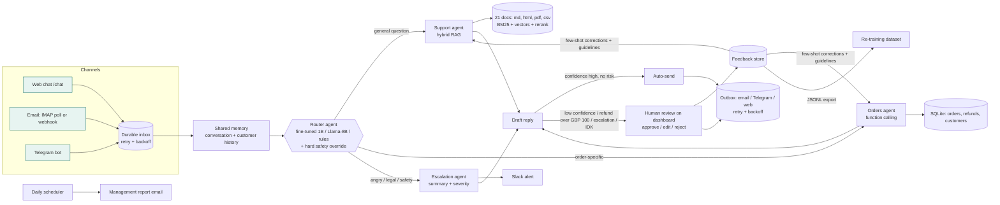

# Northwick AI Ops - Autonomous AI Operations Agent

A multi-agent system that runs a UK e-commerce company's customer operations: it answers customers from company docs (hybrid RAG with citations), takes real actions (order lookup, refunds, cancellations via function calls on a database), escalates angry or high-risk customers to a human with a summary, learns from human corrections, and reports to management.

Built for the Cadral AI engineering assessment. Stack: **Python 3.12, FastAPI, SQLite, Groq (openai/gpt-oss-120b and 20b, free tier) with a deterministic offline engine, vanilla-JS dashboard (SSE)**. Free tiers only.

## Architecture



**Key design points**

| Area | Implementation |
|---|---|
| Router | Classifies each message into support / orders / escalation. Uses the fine-tuned model when `FT_BASE_URL` is set, else Groq `openai/gpt-oss-20b`, else rules. High-risk signals (legal, safety, abuse, "speak to a manager") **always** override the model. |
| Support agent (RAG) | 21 docs (12 markdown policies, 5 web pages, 3 PDFs, products CSV) -> 79 section-aware chunks. **Hybrid search**: BM25 + hashed n-gram vectors fused with RRF, then a feature **reranker** (idf-weighted coverage, phrase hits, title match, vector sim). A confidence gate returns **"I don't know"** (and hands off to a human) rather than guessing. Every answer carries `[n]` citations. |
| Orders agent | Real tools: `get_order_status`, `list_customer_orders`, `issue_refund`, `update_order`. Policy is enforced **server-side** (ownership check, 30-day window, no double refunds, refunds over GBP 100 require manager approval); customer identity is injected by the server, never taken from the model. |
| Escalation agent | Detects anger, legal threats, safety incidents, profanity, shouting, human requests. Creates an escalation record with severity + summary, alerts Slack, sends a holding reply. |
| Shared memory | Per-conversation history + customer profile (tier, past chats, prior escalations, refunds, recent orders, "order last discussed" for follow-ups like *"refund it"*). |
| Self-improving loop | Edits/rejections/approvals are stored. (1) Similar past corrections are injected as few-shot examples / reused for near-identical questions, (2) reviewer notes become standing guidelines in every prompt, (3) `POST /api/feedback/export` writes a JSONL re-training set consumed by `finetune/train_lora.py --extra`. |
| Reliability | Messages are persisted **before** processing. Failures retry with exponential backoff (5 attempts), Slack is alerted, and the conversation is escalated if it still fails. Outbound email/Slack/Telegram go through a retrying outbox. LLM calls retry on 429/5xx and degrade to the offline engine. In-flight work is recovered on restart. |
| Channels | Web chat widget (`/chat`), email (IMAP polling **and** `POST /api/channels/email` webhook), Telegram bot (long polling). |
| Automation | Daily management report (volume, top issues, refunds, escalations, AI accuracy, cost) emailed at `REPORT_HOUR_UTC`; Slack alerts for escalations and system errors. |
| Dashboard | Login with **admin / agent** roles; live conversation view with **streamed replies (SSE)**; agent trace (which agent, which tools, why, retrieval scores); approve/edit/reject; analytics (auto-resolution %, response time, cost per conversation, accuracy over time); admin: learning loop, refunds approval, outbox, report preview. |

## Quick start

```bash
git clone <your-repo-url> && cd <repo-folder>
cp .env.example .env             # add GROQ_API_KEY (free at console.groq.com); leave blank for offline engine
pip install -r requirements.txt
python scripts/gen_data.py       # (already committed) regenerates the 21-document knowledge base
uvicorn app.main:app --reload    # http://localhost:8000  (dashboard)   http://localhost:8000/chat (customer widget)
```

Default logins (change in `.env`): `admin@cadral.test` / `ChangeMe-Admin1`, `agent@cadral.test` / `ChangeMe-Agent1`.
Demo customers: `alice@`, `bob@`, `carol@`, `dave@`, `emma@`, `frank@`, `grace@`, `henry@example.com` with orders `ORD-1001`..`ORD-1016`. `python scripts/demo_traffic.py` sends a realistic batch.

**Docker:** `docker compose up --build` (secrets via `.env`; nothing is baked into the image).
**Free deploy:** `render.yaml` deploys the Docker image on Render's free tier; set `GROQ_API_KEY`, `SLACK_WEBHOOK_URL`, passwords in the dashboard.

## Evals (one command)

```bash
python -m evals.run_evals            # uses Groq if GROQ_API_KEY set, else offline engine
python -m evals.run_evals --offline  # deterministic, no network
python -m pytest tests -q            # unit/integration tests
```

65 labelled cases (25 RAG-with-citation, 8 "I don't know", 21 order/tool cases that also verify **DB side-effects**, 1 multi-turn memory, 10 escalation incl. Slack + severity). Each runs through the real pipeline on a fresh database. Reports routing accuracy, per-category pass-rate, p50/p95 latency, tokens and cost per request. Latest results: see `docs/WRITEUP.md`.

## Fine-tuning

`finetune/` fine-tunes **Qwen2.5-1.5B-Instruct** with LoRA as the router classifier, on 1,200 synthetic examples, tested on a **held-out 180-message set written in different phrasing** (typos, slang, lowercase). `finetune/colab_finetune.ipynb` runs everything on a free Colab T4 (~10 min) and fills `finetune/results.json` (accuracy, macro-F1, latency, cost) for: rules baseline, base 1.5B, fine-tuned 1.5B and a 70B API model. Serve the result with llama.cpp/Ollama and set `FT_BASE_URL`.

## Repo layout

```
app/        agents.py (router + 3 agents) rag.py tools.py memory.py feedback.py pipeline.py llm.py notify.py worker.py reports.py main.py static/
data/docs/  21-document knowledge base        scripts/  data generators, demo traffic
evals/      cases.py (65 cases) run_evals.py  finetune/ dataset, LoRA training, comparison, Colab notebook
tests/      pytest suite                      docs/     WRITEUP.md
```

## Security & config

All secrets are environment variables (`.env` is git-ignored; `.env.example` lists them). Passwords are PBKDF2-hashed, tokens HMAC-signed, the email webhook requires a shared secret, order tools verify the customer owns the order, and `/chat` messages are length-limited.
